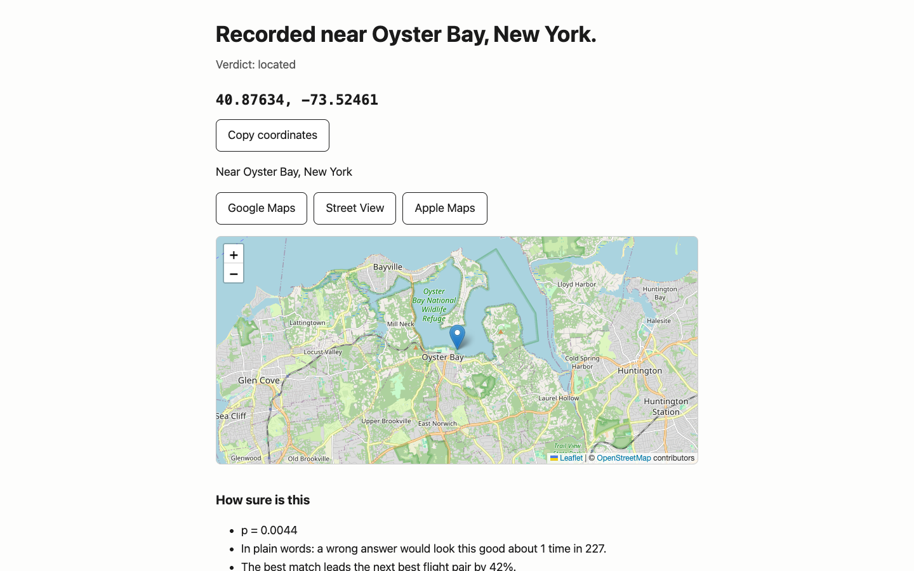
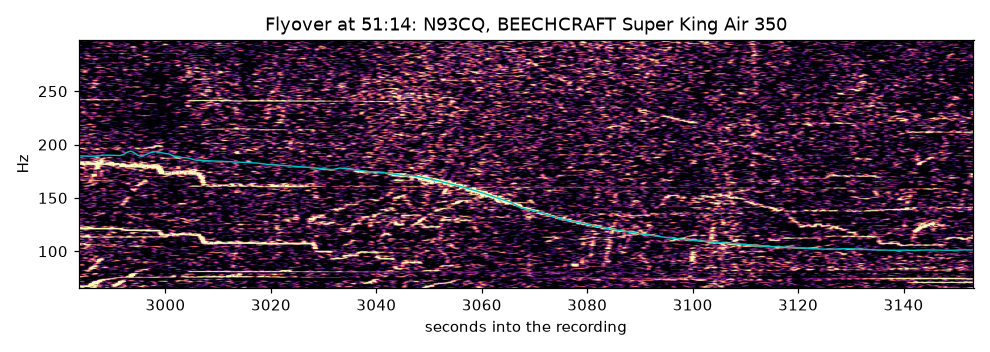

# flyby

Send a video, get where it was filmed.

```
flyby https://youtu.be/4CxVxuMVkMc --date 2026-09-08
```



Propeller planes leave a faint falling tone in almost any outdoor recording. The
shape of that tone depends on where the microphone was. flyby finds those tones,
matches them against the public record of where every tracked aircraft was that
day, and reports the one spot on the ground that would have heard them all.

It is a one-command wrapper around [dopplertrack](https://github.com/mjshiggins/dopplertrack),
which does the physics. flyby adds what that engine leaves to you: getting the
audio, working out the day and the area, picking and measuring the flyovers,
fetching the flight data, and saying honestly whether the answer can be trusted.

## Use

```
flyby <link or file> [--date D] [--start UTC] [--area PLACE]
```

| Option | What it does |
|---|---|
| `--date 2026-09-08` | the local day it was recorded (or a range `A..B`) |
| `--start 2026-09-08T20:17` | when the recording began, in UTC, to a few minutes |
| `--area "Florida"` | search one state or city instead of the whole USA |
| `--bbox LATMIN LATMAX LONMIN LONMAX` | search an exact box |
| `--days-back 2` | for uploads: how many days before the upload day to try |
| `--searches 6` | most searches to run before giving up |
| `--workers 12` | cores for the search (default: two thirds of them) |
| `--no-open` | do not open the result page |

Nothing is required but the link. The day and area come from the video when it
states them:

| Source | Day | Area |
|---|---|---|
| replay of a finished live stream | exact, from the stream's own start time | whole USA |
| normal upload | the upload day, then back `--days-back` days | whole USA |
| local file | the file's recording time; its GPS tag if it has one | whole USA, or 80 km round the GPS tag |
| old footage uploaded later | cannot be known: give `--date` | whole USA |

It needs `yt-dlp`, `ffmpeg` and `uv`. No API key and no account.

## What you get

The run on the reference clip (an hour of audio from a yard, day known, place not):

```
LOCATED  Recorded near Oyster Bay, New York.
Location: 40.87634, -73.52461
p = 0.0044; a wrong answer would look this good about 1 time in 227
Recording started: 2026-09-08 20:17:29 UTC

Aircraft   Type                            Heard (UTC)   Distance km
N22NY      PILATUS PC-12                   20:53:25      6.1
N93CQ      BEECHCRAFT Super King Air 350   21:08:48      3.7
N501EX     CESSNA 208 Caravan              20:30:32      8.4
N7681Y     PIPER PA-30 Twin Comanche       20:40:57      8.2
```

That is 32 m from the true spot, out of the whole continental USA, with no
window picked by hand. A page with the map, the numbers and a picture of each
predicted tone lying over the real one opens in the browser
(`~/dev/pages/flyby-<video>.html`).



## The four answers

| Verdict | Meaning | Shows a place? |
|---|---|---|
| **located** | a wrong answer would look this good less than 1 time in 100 | yes |
| **not sure** | less than 1 time in 10: a lead to check against the picture | yes, marked as a guess |
| **no match** | nothing stands out | no |
| **no flyovers** | fewer than two aircraft could be measured | no |

The engine always has a best-scoring spot, even for the wrong day or the wrong
country, so the number matters more than the map. Three things keep it honest:

- **A stricter bar.** The engine calls p < 0.1 "located", and its author saw 2
  of 20 searches with no right answer pass that. flyby asks for 0.01.
- **An honest p.** The engine's p treats the width of the wrong-answer crowd as
  known, though it is measured from a handful of scores (15 when further
  flyovers are used). Worked through properly, its 0.1 is then really 0.16 and
  its 0.001 is really 0.0075. flyby reports the corrected figure (`_lead_p` in
  `engine.py`; a test simulates 1,500 searches of pure noise and checks that
  10% of them, not 16%, fall under 0.1). With only two flyovers the crowd is
  measured from 100 scores and the correction is small (0.1 becomes 0.11).
- **Every search counts.** Each extra day or pair of flyovers searched is one
  more chance for a wrong answer to look good, so p is multiplied by the number
  of searches run. Across a full run of six this still lets a wrong "located"
  through about 2% of the time, not 1%.

If the recording's start time is known (a stream replay, a phone video, or
`--start`), flyby uses it as a second test. Every candidate answer implies a
start time, and a wrong one agrees with the real one only by luck. On the
reference clip the two main flyovers alone give p = 0.29, which is nothing; add
the true start time and it is 0.005.

## What to expect

- It needs propeller aircraft that broadcast their position, passing within a
  few kilometres. Jets do not work. Quiet rural recordings work best.
- An hour of audio is a realistic minimum. One builder who measured this on
  random outdoor webcams got a confident fix on roughly 4% of 30-minute clips
  and 9% of one-hour clips. A short phone clip will almost always say "no
  flyovers".
- Time, measured on this Mac (18 cores, shared with other work):

| Step | Time |
|---|---|
| audio, tones, measuring (1 h clip) | about 2 min |
| flight tracks for one day, first time only | 15 to 30 min (a 4 GB stream) |
| one whole-USA search | 10 to 20 min |
| the whole run when the state is given (`--area "New York"`) | about 1 min |

- Disk: each whole-USA day index is about 6 GB and is kept, so no day is ever
  streamed twice.
- Memory: building a day index takes about 14 GB for a minute or two. flyby
  checks that 16 GB is free before it starts the download, and stops with a
  plain message if not.
- The search runs at low priority on two thirds of the cores, so the Mac stays
  usable. Ctrl-C stops it and every worker it started. Run the same command
  again and every finished step is kept (audio, tones, day indexes, finished
  searches); a download or search that was cut short starts over.
- Exit codes: 0 located, 3 searched but not located, 1 could not run, 130
  stopped.

## How it works

```
1 ingest    yt-dlp / ffprobe: the audio, the upload or stream time, any GPS tag
2 clues     which UTC days to search, and which box
3 measure   the engine finds candidate tones; flyby refits each in a tight window
            and sets aside hums, trucks and unstable fits
4 tracks    that day's adsb.lol archive, streamed into an index of propeller flights
5 search    the engine ranks every spot + flight pair; further flyovers confirm
6 judge     how likely a wrong answer would look this good; stop at the first
            strong match
7 report    50 m refinement, the matched aircraft, terminal summary, map page
```

| File | Job |
|---|---|
| `src/flyby/cli.py` | the command |
| `src/flyby/ingest.py` | link or file to audio and facts |
| `src/flyby/clues.py` | days and area |
| `src/flyby/measure.py` | finding and measuring flyovers |
| `src/flyby/dayindex.py` | streaming a day of flight tracks |
| `src/flyby/engine.py` | search plan, judging, pinning the spot down |
| `src/flyby/report.py` | terminal summary and the page |
| `src/flyby/runner.py`, `ui.py`, `paths.py`, `model.py` | engine subprocess, progress display, folders, shared shapes |

Everything flyby keeps is in `data.noindex/` inside this folder (set `FLYBY_HOME`
to move it): `days/` holds the day indexes, `runs/<video>/` holds one run's
audio, measurements, search tables, logs and figures. Delete a day index or a
run folder whenever you want the space back; flyby rebuilds what it needs.

```
uv run pytest          # 81 tests, offline, about 5 s
```

## Limits

- The lower 48 states by default. Anywhere else works with `--area` or `--bbox`
  if adsb.lol has receivers there.
- Aircraft that do not broadcast (many small or old planes, most military) are
  invisible to it. Then the honest answer is "no match".
- A stream that is still live is refused: the flight archive for a day appears a
  few hours after the day ends.
- A recording that runs across midnight UTC (late afternoon in the USA) is
  searched one day at a time, so a pair of flyovers on either side of midnight
  is missed.
- Slow passes fitted at the engine's lowest speed (35 m/s) are set aside with
  the hums.
- The junk filter and the 110 s fit window were tuned on one reference clip.

## Credits

- Method: colsto, ["I discovered a sound that leaks your exact location"](https://www.youtube.com/watch?v=UytYrhYLOKI).
- Engine: [dopplertrack](https://github.com/mjshiggins/dopplertrack) by mjshiggins, MIT, pinned to commit `2d899bb`.
- Flight tracks: [adsb.lol](https://adsb.lol), ODbL. Aircraft types: ICAO Doc 8643 via OpenSky.
  Elevation: Mapzen Terrarium tiles on AWS. Map and place names: OpenStreetMap.

Use it on your own recordings and on public footage such as webcams. It is not
for working out where a private person lives.
